<p align="center">
  <picture>
    <source media="(prefers-color-scheme: dark)" srcset="docs/media/hero-dark.svg">
    <source media="(prefers-color-scheme: light)" srcset="docs/media/hero-light.svg">
    
  </picture>
</p>

<p align="center">
  
  
  
  
  
  <br>
  
  
  
</p>

<p align="center">
  <b>Latidos</b> (Spanish for <i>heartbeats</i>) is a living local panel of your <b>Claude Code</b> and <b>Cursor</b> use:<br>
  tokens and API-equivalent cost in euros and dollars, per project, task and account,<br>
  over your whole history and live while your sessions run.
</p>

<p align="center">
  <a href="#works-with"><b>Works with</b></a> ·
  <a href="#light-on-your-machine"><b>Footprint</b></a> ·
  <a href="#let-an-agent-install-it"><b>Agent install</b></a> ·
  <a href="#quickstart"><b>Quickstart</b></a> ·
  <a href="#what-you-see"><b>What you see</b></a> ·
  <a href="#a-quick-tour"><b>Tour</b></a> ·
  <a href="#how-it-works"><b>How it works</b></a> ·
  <a href="#configuration"><b>Configuration</b></a> ·
  <a href="#safety"><b>Safety</b></a>
</p>

<p align="center"></p>

<p align="center">
  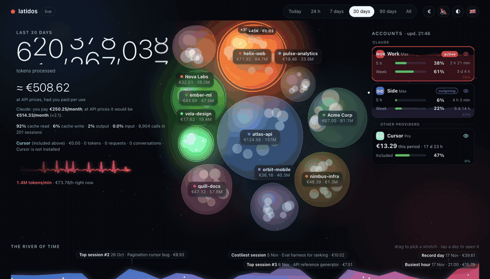
</p>
<p align="center"><sub>Every call your agents make flies as a spark into its project's cell, the counter rolls and the ECG beats. All data in these images is synthetic (<a href="#the-demo-behind-these-images"><code>demo/</code></a>).</sub></p>

<table>
  <tr>
    <td width="33%" valign="top">
      <h3>🫀 Your history, kept</h3>
      Every call goes into its own SQLite file, so the history survives Claude Code's 30-day cleanup. Months later you still know where the tokens went.
    </td>
    <td width="33%" valign="top">
      <h3>💶 Money, not just tokens</h3>
      Each call is priced at the public API rate (cache tiers, fast mode), in euros and dollars, next to what your plan really costs you.
    </td>
    <td width="33%" valign="top">
      <h3>🔒 Nothing leaves</h3>
      Python standard library, bound to <code>127.0.0.1</code>. It only reads your agents' local files; the daily exchange rate and Cursor's own usage API are the only calls out.
    </td>
  </tr>
</table>

## Works with

| | Agent | Status | What Latidos reads |
|:-:|---|---|---|
| ✅ | **Claude Code** |  | Every call in its transcripts (`~/.claude*/projects`): tokens per cache tier, model, project, branch, session title, account. Direct API, Bedrock and Vertex model ids |
| ✅ | **Cursor** |  | Its local files (conversations, titles, projects) and its own usage API: per-request tokens and the cost Cursor charges |
| ✅ | **OpenAI Codex CLI** |  | Its rollout files (`~/.codex/sessions`, `$CODEX_HOME`): tokens per call (cached input apart), model, folder, first prompt. Priced at OpenAI list prices. Checked on fixtures only |
| ✅ | **Gemini CLI** |  | Its session files (`~/.gemini/tmp/*/chats`): tokens per reply (cached and thinking apart), model, folder (the hashed project folder matched against folders Latidos knows). Priced at Google list prices, with the 200k tier. Checked on fixtures only |
| ✅ | **Google Antigravity** |  | Its conversation files (`~/.gemini/antigravity/conversations`, titles from `brain/`). They are opaque protobuf with no token counts, so it shows active days, no cost. Checked on fixtures only |
| ✅ | **GitHub Copilot** |  | Copilot Chat sessions in VS Code (`workspaceStorage/*/chatSessions`, JSON and the newer journal): requests, model, workspace folder. No token data on disk in most versions: requests, no cost, unless a session records usage. Checked on fixtures only |
| ✅ | **Windsurf** |  | Its Cascade conversation files (`~/.codeium/windsurf/cascade`): opaque protobuf, active days only, no cost. Checked on fixtures only |
| ✅ | **Cline / Roo Code** |  | Their task folders in any VS Code family editor (`globalStorage/<extension>/tasks`; Kilo Code too): tokens per request with cache tiers and the cost the extension computed, model, folder, task title. Checked on fixtures only |
| ✅ | **Aider** |  | `.aider.chat.history.md` in the repositories under your code folders: tokens and the cost Aider printed per message, model, first prompt (calls placed a second apart from the session start). Checked on fixtures only |
| ✅ | **OpenCode** |  | Its storage (`~/.local/share/opencode/storage`): tokens per message with cache tiers, the cost OpenCode recorded, model, session title and folder. Checked on fixtures only |

Sessions of every supported agent land in the same cells, river and counter: one picture of
everything your agents spend. Each agent other than Claude Code and Cursor is an origin of its
own: cells in its own hue family, a line under the counter with an eye to hide it (remembered
in the browser), marks on the day strip, a ranking and a project sheet. Each one has a small
reader in `agents.py` for the files it keeps on disk; an agent whose files are not on the
machine stays out of sight. Cost is the one the tool recorded when it records a positive
figure; a recorded 0 (a subscription or free tier) and tools that record none use the
model's API list price, like Claude Code's calls (OpenAI, Gemini, DeepSeek, Grok, Mistral, Qwen, Kimi, GLM and Claude
ids; a catch-all row never prices a cheaper tier such as mini or flash at the full rate);
a model with no known price keeps its tokens and shows as unpriced, never a guess, and the
same counter appears under the hero for Claude Code calls of an unknown model. Antigravity
and Windsurf count distinct active days. The first scan of a large history is spread over
several passes of at most 5 s each.
"Checked on fixtures only" means the reader follows the tool's documented layout and is
tested on synthetic files, not yet on a real machine's history.

## Light on your machine

<p align="center">
  
</p>

Measured on the author's Mac with `ps`, after 16 hours of service: **about 43 MB** of
resident memory, **0 % CPU** between scans and about 3 % of one core on average, and a
**45 MB** SQLite file for 107,000 calls read from 5 GB of transcripts. Files are read
incrementally from their last byte offset, so a scan only touches the new lines. The
animations are drawn by your browser tab, not by the service.

## Let an agent install it

Latidos is built to be installed by the agents it watches: no dependencies, no `sudo`,
one command per step, each one safe to run again and each one with a check.
Paste this to Claude Code, Cursor or any coding agent on the machine:

```text
Install Latidos on this machine following docs/agent-install.md from
https://github.com/yupipi93/latidos. Run every check, keep it on 127.0.0.1,
do not overwrite my config, and tell me the URL and what the first scan found.
```

The steps it follows are in [`docs/agent-install.md`](docs/agent-install.md): check
Python, clone or update, see whether a Latidos already answers, first scan, LaunchAgent on
macOS or a systemd user unit on Linux, then `latidos.py status` must say `"ok": true`.

## Quickstart

```bash
git clone https://github.com/yupipi93/latidos.git && cd latidos
python3 latidos.py ingest          # first scan of ~/.claude/projects (about 30 s for 4 GB of logs)
python3 latidos.py serve           # http://127.0.0.1:7482
```

Keep it running on macOS:

```bash
python3 latidos.py install         # LaunchAgent (label from config, default local.latidos)
python3 latidos.py status          # health JSON
python3 latidos.py uninstall
```

Optional configuration (see [Configuration](#configuration)):

```bash
mkdir -p ~/.config/latidos
cp config/config.example.json ~/.config/latidos/config.json
cp config/boards.example.json ~/.config/latidos/boards.json
cp config/aliases.example.json ~/.config/latidos/aliases.json
```

After a code change or a `config.json` change, restart the service
(`launchctl kickstart -k gui/$(id -u)/<label>`). `aliases.json` is re-read on the fly.

<details>
<summary><b>Requirements and platform notes</b></summary>

- Python 3.9 or newer, standard library only. Node 18+ only to run the JavaScript tests,
  Node 22+ and Google Chrome only for the screenshot helper `shoot.mjs`.
- **macOS** is the main platform: `latidos.py install` writes a LaunchAgent, and the
  Cursor source reads Cursor's macOS files (`~/Library/Application Support/Cursor`).
- **Linux**: `latidos.py serve`, `ingest` and `summary` work; run `serve` under your own
  service manager (systemd user unit, for example). Without Cursor installed, the Cursor
  source simply stays empty.
- Windows is not supported (the ingest lock uses `fcntl`).
</details>

## What you see

<p align="center">
  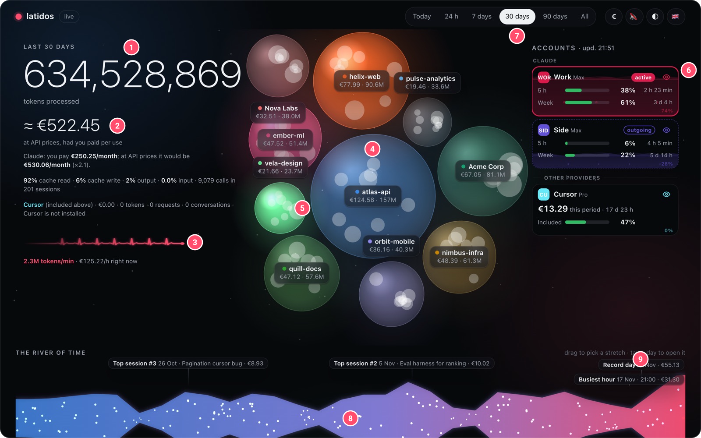
</p>

| | Piece | Meaning |
|:-:|---|---|
| **1** | Rolling counter | Tokens processed in the range (input, output, cache read, cache write), as an odometer |
| **2** | API-equivalent cost | What the range would cost at API prices, next to what your Claude plan costs per month |
| **3** | ECG | A soft beat every second, a tall one when live calls arrive; tokens per minute and cost per hour of the last 15 minutes |
| **4** | Cells | One per project, area proportional to cost; orbiting dots are its biggest tasks. Drag cells, tap one (or a ranking row) for its task list |
| **5** | Live calls and freshness | Each new call flies as a spark into its project's cell, which pulses and shows a "+tokens · cost" tag. Cells that received tokens lately are vivid; quiet ones fade (log scale, a month to fully fade). On a phone the space runs on behind the account cards and a spark crosses the cards above them, faint while over one |
| **6** | Accounts (optional) | One card per Claude account (5-hour and weekly use, reset time) and one for Cursor, when an accounts source is configured. Each card has an eye switch that shows or hides that account's activity everywhere on the page, its share of the range's spend as faint water in the card's colour that fills it from the bottom (with the figure small in the corner), and its login's expiry (Claude: with a Renew button when `account_logins_tool` is set) |
| **7** | Ranges and chips | Today, 24 h, 7, 30 (default) and 90 days, all, or a dragged range (kept in the URL hash); currency, sound, theme and language chips |
| **8** | River of time | Cost per hour or day; drag to pick a range, tap a day to zoom in |
| **9** | Moments | Record day, busiest hour and top sessions, tagged on the river |
| | Project sheet | A project's tasks by cost or by most recent, live rows flashing as calls arrive; the dot of the task with the last activity blinks (hover it for when) |
| | Sound (optional) | The speaker chip (or `S`) rings a soft note for each spark that lands: D major pentatonic over a slow chord progression, snapped to a gentle beat, high and light for small calls, low with a bass for big ones, panned to the cell. Off by default; it plays only while the tab is in view and starts with your first click or key |
| | Ranking and models | The same numbers as a plain list |

**Keys:** `1`-`6` ranges, `K` show or hide Cursor, `S` sound, `R` reload, `T` theme, `C` currency,
`Esc` close. Zoom the cells with the wheel, a pinch, `+` / `-` / `0`.

The page is in English or Spanish: English by default, the flag chip in the header switches
(the choice is kept in the browser), and `?lang=es` or `?lang=en` in the URL overrides both.

## A quick tour

<table>
  <tr>
    <td width="50%" valign="top">
      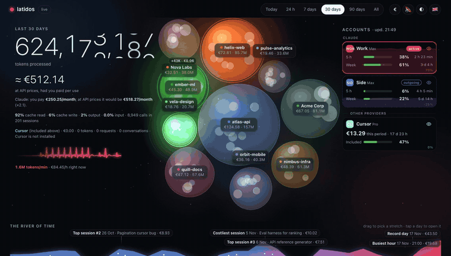
      <p><b>Any range in one key.</b> All time, a week, today: the counter rolls to the new total and the cells regrow to their share. Standard ranges are kept warm, so a switch paints at once.</p>
    </td>
    <td width="50%" valign="top">
      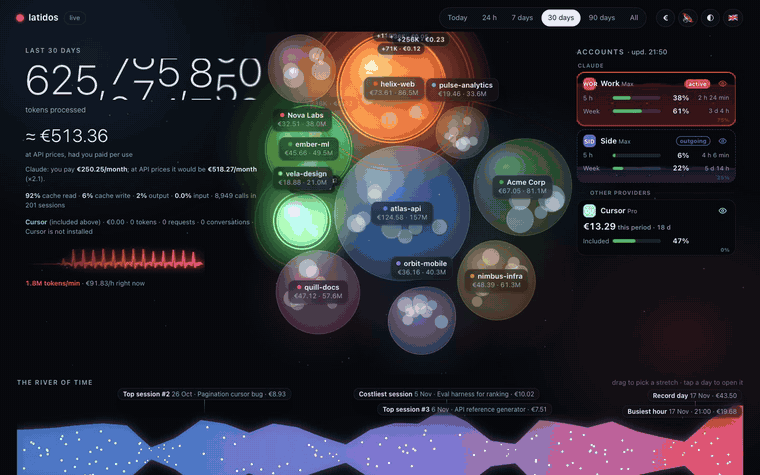
      <p><b>Open a project.</b> Its tasks by cost or by most recent, each with its account or provider, live rows flashing as calls arrive. Rename a project or move a task to another one from here.</p>
    </td>
  </tr>
  <tr>
    <td width="50%" valign="top">
      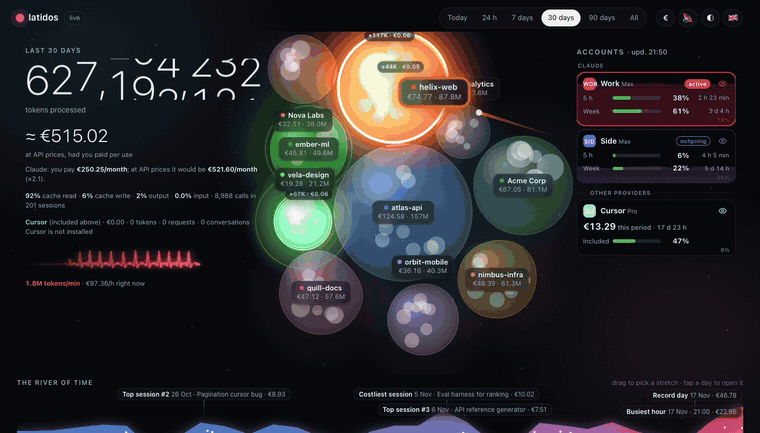
      <p><b>Light and dark.</b> Follows the system, or <code>T</code> to choose. Euros or dollars with <code>C</code>.</p>
    </td>
    <td width="50%" valign="top">
      
      <p><b>Numbers that roll.</b> Every figure moves like an odometer, so a live call is something you see, not a digit that flips.</p>
    </td>
  </tr>
</table>

<table>
  <tr>
    <td width="34%" align="center" valign="top">
      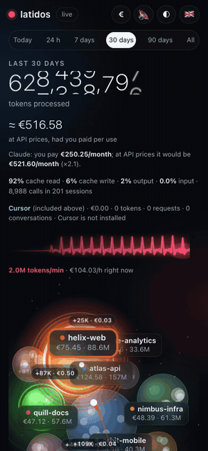
      <br><sub><b>On the phone</b>, live</sub>
    </td>
    <td width="33%" align="center" valign="top">
      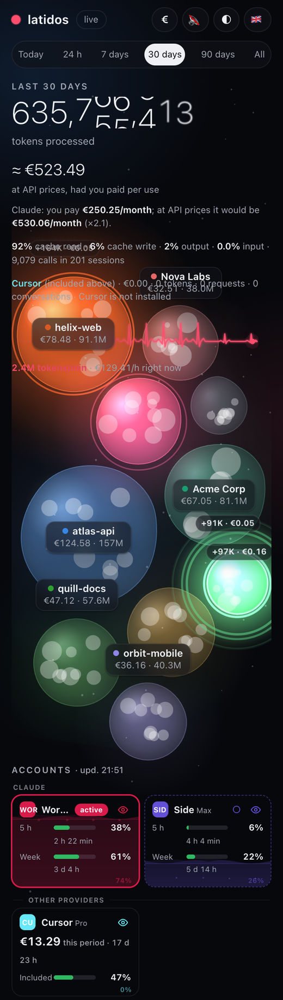
      <br><sub>Dark</sub>
    </td>
    <td width="33%" align="center" valign="top">
      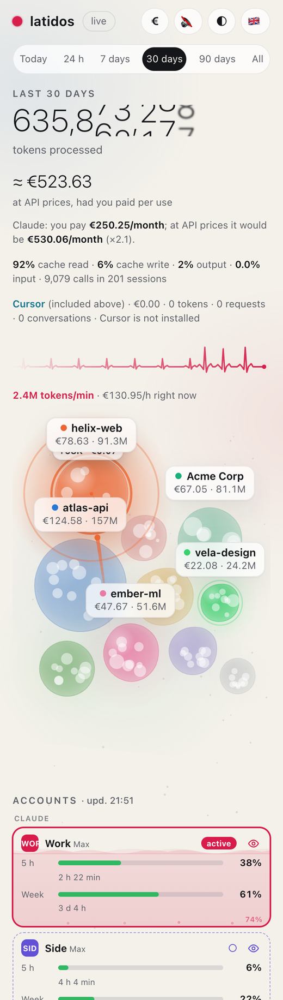
      <br><sub>Light</sub>
    </td>
  </tr>
</table>

<details>
<summary><b>Full-size desktop screenshots</b></summary>
<br>
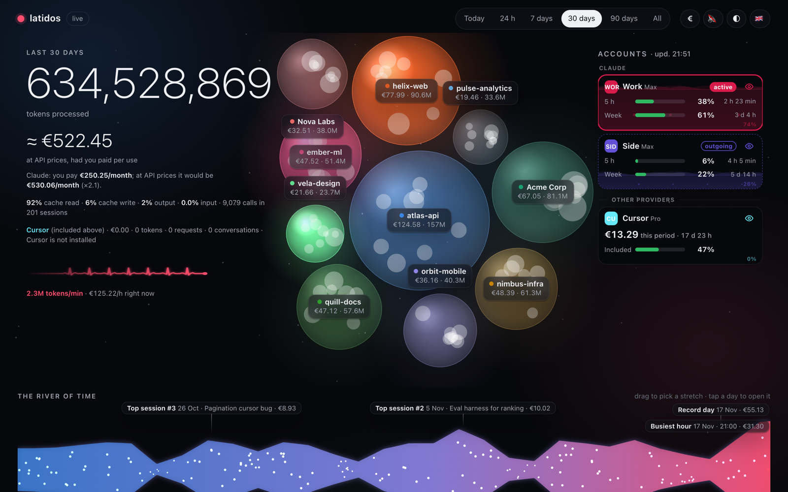
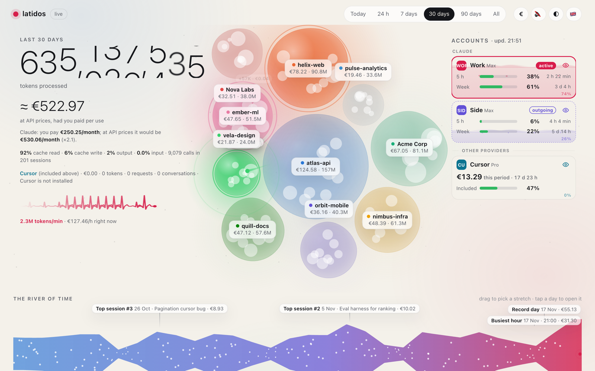
</details>

## How it works

<p align="center">
  
</p>

Latidos reads the transcripts Claude Code writes on your machine, keeps every call in its
own SQLite database (so history survives Claude Code's 30-day cleanup), prices each call
at the public API rate and serves an animated page on `127.0.0.1`. Nothing leaves the
machine except the daily exchange rate and, if you use Cursor, Cursor's own usage API
called with your Cursor session.

### How the numbers are made

- **Source**: every `*.jsonl` under the configured roots (default `~/.claude/projects`).
  Each assistant message's `usage` is stored once, keyed by message id (the largest
  values win while it streams). Files are read incrementally from their last byte
  offset, every 10 s while a page is open and every 30 s otherwise.
- **Cost**: public Anthropic API prices per model, table `PRICES` in `latidos.py`
  (input, output, cache read, 5-minute and 1-hour cache writes; fast mode x2).
- **Euros**: ECB rate from frankfurter.app, fetched once a day and cached; without a
  stored rate, `LATIDOS_EUR_FALLBACK`.
- **Project**: the repository of the session's working directory (`<code_dir>/<repo>`,
  `<projects_dir>/<repo>`, `<projects_dir>/<group>/<repo>`, worktrees under
  `~/.treehouse`, `~/.worktrees` and `~/.t3/worktrees`). When the session ran in an agent
  workspace (see below), the home folder or a temp folder, the project is the repository
  its tools touched most (at least 3 hits and 40 % of them); otherwise a ticket key in
  the branch or session title maps to a client through `boards.json`.
- **Task**: the ticket key when there is one, else the session (its custom or AI title).
- **Smart classification** (optional, `classify.py`, next section): a model splits each
  session into segments and names their client, project and task. It replaces the two
  rules above for every session it has seen; tasks moved by hand still win.
- **Plan estimate** (`accounts` in the API): plans in multiples of a Claude Pro
  allowance, calibrated on the busiest 5-hour window and week. The page no longer shows
  it; the server still computes it.

## Smart classification

Folder rules put a whole session in one cell: a long session that moved from one client
to a tool and back, or client work started from an agent workspace or a notes vault,
lands in the wrong place. `classify.py` asks a model instead.

- For each session it builds a dossier from the transcript: every prompt you typed (not
  subagent notices or command echoes), the cost of the work until the next prompt, the
  repositories the tools touched, the git branch. Short follow-ups ("yes", "go on") join
  the turn before; long sessions are capped at 120 turns by merging the cheapest ones.
- Dossiers go in batches to `claude -p` (default model `claude-opus-5-5`, no tools, no
  settings, no MCP servers, run from `~/.local/state/latidos/classifier`, so its own cost
  shows in Latidos under automation). The model returns segments: where the work changed,
  its kind (`client`, `internal`, `tool`, `personal`), client, project, task and ticket.
  A catalog of the project names used so far goes with every batch so names stay stable.
- The result is `classified.json` in the config folder. Latidos re-reads it within seconds.
  It also holds `folders`: a repository whose classified work mostly went to one project
  sends new, not yet classified sessions there.
- **Client grouping**: work with a client (kinds `client` and `internal`) is grouped per
  client. A client's project gets its own cell, "Client · Project", when it weighs at
  least `LATIDOS_FOLD_SHARE` (default 0.03, 3 %) of the range; smaller ones share the
  client's cell, where each task row starts with its project. A client with a single
  project shows as the client. Live calls follow the same grouping (`fold` in the summary).
- Moving a task by hand works per segment: the key of segment n of a session is
  `s:<session id>.<n>`, so a move never covers segments the classifier adds later. A move
  stored as `s:<session id>` (made before the session was classified) covers all of them.
- The classifier never classifies its own `claude -p` sessions (those run from its work
  folder). One run at a time: `run` and `consolidate` share a lock.

```bash
cp config/taxonomy.example.json ~/.config/latidos/taxonomy.json   # your clients, tools
python3 classify.py run --dry-run          # print the first dossiers, call nothing
python3 classify.py run --jobs 4           # classify everything not classified yet
python3 classify.py consolidate            # one call that merges duplicate project names
python3 classify.py status
python3 classify.py install                # LaunchAgent: `run` every 30 minutes
```

`taxonomy.json` (optional) tells the model who you are, your employer (the client name of
internal work), your clients with what identifies them (boards, products, repositories)
and your own tools. Runs are incremental: a session is sent again only when it has new
prompts, and then only those. Prompts younger than 3 minutes wait for the next run.

## Cursor

Two sources, combined: Cursor's local files (`state.vscdb` opened read-only,
`~/.cursor/ai-tracking`, `~/.cursor/chats`) give conversations, titles and projects;
Cursor's dashboard usage API (`cursor.com/api/dashboard/get-filtered-usage-events`)
gives per-request tokens and the cost Cursor charges, for about the last year.

The session token is read from `state.vscdb` on each pass, sent only to cursor.com in
the cookie its own dashboard uses, and never stored, logged or returned. Redirects are
refused. The endpoint is undocumented and may change; `LATIDOS_CURSOR_API=0` turns it off.

## Claude accounts

`accounts/` holds the tools that run Claude Code under several Claude.ai subscriptions on
one Mac: an automatic switch with a smart hierarchy (the weekly room left weighs more than
the priority), the Cursor and T3 Code switch steps, a shared pool of chats and memory, a
headless fallback, the wake-up of chats cut by a usage limit, an early warm-up and login
renewal. They are separate from the panel (the server never runs them by itself): the
account cards call `accounts/claude-account-control.py` through `account_control` when you
click. Their accounts come from `~/.config/latidos/claude-accounts.json`
(`config/claude-accounts.example.json`). Details and setup: `accounts/README.md`.

## Configuration

User configuration lives in `~/.config/latidos/` (or `$XDG_CONFIG_HOME/latidos`, or
`LATIDOS_CONFIG_DIR`). Every file is optional; the repository ships synthetic examples in
`config/`.

<details>
<summary><b><code>config.json</code>: every key</b></summary>

| Key | Default | Meaning |
|---|---|---|
| `roots` | `["~/.claude/projects"]` | Claude Code transcript folders; globs allowed (`"~/.claude-archive/*"`). Checked at startup and again on every scan; see "Which folders are walked" |
| `allow_home_folders` | `[]` | Names of folders right under the home folder that may be roots although they are not dot-folders, e.g. `["claude-logs"]` for `~/claude-logs` |
| `code_dir` | `~/code` | Folder of your repositories |
| `projects_dir` | `<code_dir>/projects` | Folder of repositories and groups of repositories |
| `workspaces` | `["agent-skeleton"]` | Agent workspaces under `code_dir`: their sessions count for the repository their tools touched, and `<workspace>/projects/<repo>` counts as `<repo>` |
| `accounts_url` | `""` (off) | Local server for the account cards. It must answer `GET /api/claude-quota` (`{"updated_at", "accounts": [{"tag", "label", "active", "plan", "session": {"percent", "resets_at"}, "weekly": {...}}]}`) and `GET /api/cursor-usage`. Only `127.0.0.1` / `localhost` is read. Without it the cards are hidden |
| `account_colors` | `{}` | Card colour per account tag, e.g. `{"work": "#d81b4a"}` |
| `account_logins` | `{}` | Where each account tag's Claude Code login lives: its config folder (`~/.claude-work`) or `.claude.json`; for the default `~/.claude` the file next to it (`~/.claude.json`) is used. Only the account id is read. Each call is credited to the account in its transcript (`session-owner`), sparks fly from that card, and a non-active account with calls in the last 30 min shows an "outgoing" badge. Subagent calls take their session's latest account. Empty: every call flies from the active card. The same tags label every task in a cell's sheet ("Claude · mt", with shares when a task mixes accounts) and the cell's split under its stats; a call on Bedrock or Vertex (read from the model id) or a non-Claude model shows that provider instead, an account not listed here or a call older than the owner records shows plain "Claude", and Cursor conversations show "Cursor". Bedrock and Vertex are told only when the transcript keeps the provider's model id |
| `account_logins_tool` | `[]` (off) | Command that reports and renews the Claude logins, as an argv prefix (`["python3", "~/latidos/accounts/claude_accounts.py"]`). It must answer `status --json` (`{"accounts": [{"tag", "state": "ok"/"soon"/"expired"/"missing"/"wrong", "expires_at", "days_left", "renewing"}]}`; anything else it prints, e-mails included, never reaches the page) and `login <tag>` (run detached after a click on Renew; `claude_accounts.py` opens claude.ai in that account's Chrome profile). Cursor's session expiry is read from Cursor's own token (`exp` only) without it |
| `account_control` | `[]` (off) | Command that lets the account cards change the default Claude account, as an argv prefix (`["python3", "~/bin/claude-control.py"]`, `~` expanded). It must answer `state` (`{"active", "order": [tags], "accounts": [{"tag", "rank", "weight", "score", "session_room", "weekly_room", "fresh", "usable", "spent"}], "best", "auto": {"enabled"}, "activation": {"tag", "phase", "started_at", "ok", "error", "tabs"}}`), `activate <tag>` (may take minutes; it writes its progress where `state` reads it, and reports a run that died as `phase: "done"`, since Latidos treats any other phase as running) and `order <tag,tag,...>` (`{"ok", "order"}`), with one JSON object on the last line of stdout. Then a right-click (long-press on a phone) on a Claude card opens a menu to make it active or change its priority, and the cards can be dragged to reorder them. Empty: the cards only show |
| `label` | `local.latidos` | launchd label used by `install` |

A key of the wrong type (a number for `code_dir`, an object for `roots`) is ignored with a
warning and keeps its default. A single string is accepted where a list is expected
(`"roots": "~/.claude/projects"`). An empty string counts as unset (default), and so does a
`roots` list with no folder in it (`[]`, `[""]`), with a warning. A file that is not valid
JSON, or is nested too deeply to parse, is ignored with a warning.

</details>

<details>
<summary><b>Which folders are walked</b></summary>

Every scan expands the root globs again and checks each folder it gets, so a root that
appears later, or a root link pointed somewhere else after the start, is checked too.
A refused root is skipped with one warning in the log. Refused:

- the filesystem root, the home folder, any folder above it or holding it under another
  path (`/System/Volumes/Data`), and any folder one level under the filesystem root;
  these are compared by folder identity (device and inode), so another letter case or a
  link to them counts too;
- a folder right under the home folder, unless its name starts with a dot (transcripts
  live in `~/.claude*`) or it is listed in `allow_home_folders`; also the folders right
  under `~/Library`, `~/Library/CloudStorage`, `~/Library/Mobile Documents`,
  `~/Library/Containers` and `~/Library/Group Containers`;
- system trees: `/System`, `/Applications`, `/Library`, `/usr`, `/opt`, `/bin`, `/sbin`,
  `/etc`, `/var` and the same folders under `/private` (aliases such as `/var` and
  `/private/var` get the same answer, since the resolved path is checked), except the
  per-user temporary folders three levels under `/var/folders`;
- a glob with a wildcard in the first two levels of its path (`/*/*`, `/data/*`,
  `/tmp/*`): name such folders one by one;
- volume tops and other users' homes: the folders right under `/Volumes`, `/Users`,
  `/home`, `/private`, `/mnt` and `/media`. A root that merely is a mount point somewhere
  else (a container volume at `/data/claude`, a subfolder of an external disk) is allowed.

Inside a root, a link (to a folder or a file) is followed only when its real path stays
inside the root's real path; a link that leads out is not followed, with one warning. So
a link such as `root/h -> ~/code` cannot widen the walk; a root that is itself a link
(`~/.claude/projects -> ~/.claude-shared/projects`) works, because the check uses the
root's resolved path. A folder reached twice (a link loop) is walked once.

</details>

<details>
<summary><b><code>boards.json</code>, <code>aliases.json</code> and <code>assign.json</code></b></summary>

- `boards.json`: ticket prefix to client name, `{"DEMO": "Demo Client"}`. A session in a
  generic folder whose branch or title carries `DEMO-123` counts for "Demo Client".
  Read only at startup: restart the service after editing it
  (`launchctl kickstart -k gui/$(id -u)/<label>` under launchd).
- `aliases.json`: display names, `{"old-repo-name": "new-name"}`. Applied when shown
  (stored data keeps the original names); an edit shows within seconds. The page writes
  it too: "Renombrar" in a cell's sheet.
- `assign.json`: tasks moved by hand, `{"s:<session id>": "project", "DEMO-123": "project"}`.
  A moved task counts for that project in every range and in live calls, whatever folder
  it ran in. Written by "Mover" on a task row of the sheet ("Volver a automático" removes
  the entry); also re-read within seconds when edited by hand.

The page writes only these two files, through `POST /api/rename` and `POST /api/assign`
(and, when `account_control` is set, runs that command through `POST /api/claude-control/activate`
and `POST /api/claude-control/order`; when `account_logins_tool` is set, `POST /api/logins/renew`;
same guards):
JSON bodies with the `X-Latidos: 1` header (a page of another site cannot send it without
a preflight, which the server refuses), behind the same Host guard as every request. A
file that does not parse is never overwritten (the page shows "fix it by hand first");
entries the page does not use are kept, and a symlinked file stays a link. The name
"desconocido" is reserved for the cell of unknown folders.

A file that is not a JSON object of strings is ignored with a warning on stderr.

</details>

<details>
<summary><b>Environment variables</b></summary>

| Variable | Default |
|---|---|
| `LATIDOS_CONFIG_DIR` | `~/.config/latidos` |
| `LATIDOS_CONFIG`, `LATIDOS_BOARDS`, `LATIDOS_ALIASES`, `LATIDOS_ASSIGN` | `config.json`, `boards.json`, `aliases.json`, `assign.json` in the config folder |
| `LATIDOS_CLASSIFIED`, `LATIDOS_TAXONOMY` | `classified.json`, `taxonomy.json` in the config folder |
| `LATIDOS_FOLD_SHARE` | 0.03 (share of a range a client's project needs for its own cell) |
| `LATIDOS_CLASSIFY_MODEL`, `LATIDOS_CLASSIFY_CLAUDE`, `LATIDOS_CLASSIFY_WORKDIR` | `claude-opus-5-5`, `claude` in PATH, `~/.local/state/latidos/classifier` |
| `LATIDOS_ROOTS` | `roots` from `config.json` (colon-separated) |
| `LATIDOS_HOME_URL` | `accounts_url` from `config.json` (empty turns the cards off) |
| `LATIDOS_LABEL` | `label` from `config.json` |
| `LATIDOS_PORT` | 7482 |
| `LATIDOS_HOST` | `127.0.0.1`. IPv4 or IPv6 (`::1`, with or without brackets), any letter case. A non-loopback address is used only with `LATIDOS_ALLOW_REMOTE=1`; see Safety. An address the machine cannot bind (macOS has only `127.0.0.1` on its loopback interface) falls back to `127.0.0.1` with a warning; `install` and `status` show and probe the address actually used |
| `LATIDOS_ALLOW_REMOTE`, `LATIDOS_ALLOWED_HOSTS` | unset; see Safety |
| `LATIDOS_DB` | `~/.local/state/latidos/latidos.db` |
| `LATIDOS_SCAN_SECONDS` | 30 (idle interval; 10 s while a page is open) |
| `LATIDOS_EUR_FALLBACK` | 0.86 |
| `LATIDOS_PLAN_MAIN`, `LATIDOS_PLAN_OTHER1`, `LATIDOS_PLAN_OTHER2` | 1.25, 6.25, 6.25 |
| `LATIDOS_PRICE_MAIN`, `LATIDOS_PRICE_OTHERS` | 25, 250 (USD per month) |
| `LATIDOS_CURSOR_API` | 1 (0 turns Cursor's API off) |
| `LATIDOS_CURSOR_DB`, `LATIDOS_CURSOR_TRACKING`, `LATIDOS_CURSOR_CHATS` | Cursor's default macOS locations |

Every variable is also read under its deprecated old name (`LATIDO_PORT` for
`LATIDOS_PORT`, and so on) when the new one is not set.

Rebuild the history from scratch: stop the service, delete
`~/.local/state/latidos/latidos.db*`, start it.

</details>

## Safety

Binds 127.0.0.1; any Host other than `127.0.0.1:<port>`, `localhost:<port>`, `[::1]:<port>`
or the bound loopback address itself (`LATIDOS_HOST=::1` answers `[::1]:<port>`) gets 421;
GET and HEAD, plus the page writes above (POST, JSON, `X-Latidos: 1`); static files
from a whitelist; CSP `script-src 'self'` with no inline script or style. It only reads the
session logs and the other agents' local files (`agents.py`, no network) and never sends
them anywhere. The only programs it runs are the optional
`account_control` and `account_logins_tool` commands, with the verbs above and a tag the
command itself reported (`status` of the logins tool also on its own, every minute while
the page is open).

`classify.py` is separate from the server and runs only when you start it (or install its
LaunchAgent). It does send data out: the prompts of your sessions (truncated to 320
characters each), repository and folder names, branches, costs and titles go to the
model through your own Claude Code CLI and account, the same service those sessions
already used. It reads the database read-only and writes only `classified.json`.

The page has no login. It shows session titles, ticket keys, project and branch names
and costs, so anyone who can reach the port can read them. `LATIDOS_HOST` set to a
non-loopback address (`0.0.0.0`, a LAN or tailnet IP) is ignored, with a warning, unless
`LATIDOS_ALLOW_REMOTE=1` is also set; do that only on a network you trust, or behind an
authenticating proxy. With a remote bind the loopback Host names are accepted only from
clients on this machine (a forged `Host: 127.0.0.1` from elsewhere gets 421); remote
clients must use the bound address or a name listed in `LATIDOS_ALLOWED_HOSTS`
(comma-separated, with or without `:<port>`).

With `account_control` set, whoever can reach the page can also switch the default Claude
account and reorder the priority from the cards, not only read: the same trust as the
rename and move writes. A proxy that forwards to Latidos on loopback (a tailnet or LAN
front that rewrites the Host) extends that to every device that reaches the proxy; leave
`account_control` empty on such a setup if those devices must only read. The same goes for
`account_logins_tool`: a Renew click from any of them opens a sign-in page on this Mac.

## Use with agent-skeleton

Latidos works on its own. It fits an [agent-skeleton](https://github.com/yupipi93/agent-skeleton)
workspace, where one checkout holds the agent kit and `projects/<name>` links to your
repositories: put the checkout's folder name in `workspaces` (the default is
`agent-skeleton`), and sessions started in the workspace are attributed to the
repository they worked on, not to the workspace. Paths such as `projects/<repo>/...`
and `local/bundles/<bundle>/apps/<app>/` in tool calls count as hints. Keep your
`config.json`, `boards.json` and `aliases.json` in your private overlay and copy them to
`~/.config/latidos/`.

## Upgrading from Latido

<details>
<summary><b>Up to release 70 the project was called Latido: what changed and what carries over</b></summary>

- The script is `latidos.py` (there is no `latido.py` any more) and the tests are
  `test_latidos`.
- `LATIDOS_*` variables replace `LATIDO_*`. The old names are **deprecated** but still
  read when the new one is not set, so an existing service keeps its settings.
- Folders move once, on the first `serve`, `ingest` or `summary`: `~/.config/latido` to
  `~/.config/latidos`, and `~/.local/state/latido/latido.db*` to
  `~/.local/state/latidos/latidos.db*`. It is a rename (never a copy), logged on stderr,
  skipped when the new folder already exists or a variable points the config or the
  database elsewhere, and skipped while the old database is in use by a running Latido
  (stop it first). Until the move, the old folders are read.
- The default launchd label is `local.latidos` and the log `~/Library/Logs/latidos.log`.
  `install` with a label ending in `latidos` stops the old agent (the same label without
  the final "s", when its plist runs a `latido.py`), starts the new one, then removes the
  old plist. With a label of your own, set the new one in `config.json` first.
- The page moves its saved settings (theme, currency, language, colours) from the
  `latido.*` keys of the browser storage to `latidos.*` on its first load.

</details>

## Tests

```bash
python3 -m unittest -q test_latidos     # also runs web/format.test.js and web/sound.test.js with Node
python3 -m unittest discover -s accounts -p "test_*.py"   # the account tools
node --test web/format.test.js web/sound.test.js
```

The tests use synthetic data only and never read your `~/.config/latidos`. Screenshots
with device emulation: `node shoot.mjs <outdir> <url>` (`HASH="#r=7d"`,
`SHOTS=desktop-dark,...`). The URL is required: serve a synthetic database on another
port and point it there, never at your own history, for example

```bash
LATIDOS_ROOTS=/path/to/demo-logs LATIDOS_DB=/path/to/demo.db LATIDOS_PORT=7591 \
  LATIDOS_CONFIG_DIR=/path/to/empty-dir LATIDOS_CURSOR_API=0 \
  LATIDOS_CURSOR_DB=/nonexistent LATIDOS_CURSOR_TRACKING=/nonexistent \
  LATIDOS_CURSOR_CHATS=/nonexistent python3 latidos.py serve
node shoot.mjs shots http://127.0.0.1:7591/
```

## The demo behind these images

Every image and animation in this README comes from Latidos itself, serving a synthetic
history: invented projects, tickets, accounts and costs, never anyone's real data.
`demo/` regenerates them:

```bash
python3 demo/demo.py build /tmp/latidos-demo          # 90 days of transcripts, config, fake logins
python3 demo/demo.py accounts /tmp/latidos-demo &     # fake account source on 127.0.0.1:7592
eval "$(python3 demo/demo.py env /tmp/latidos-demo)"   # its own database, config and port 7591
python3 latidos.py serve &
python3 demo/demo.py feed /tmp/latidos-demo &         # live calls for the sparks
node demo/record.mjs /tmp/rec/live http://127.0.0.1:7591/   # frames through Chrome's screencast
demo/gif.sh /tmp/rec/live docs/media/live.gif             # ffmpeg, two-pass palette
python3 demo/svg.py                                       # hero, ECG, counter, pipeline, anatomy SVGs
```

`record.mjs` takes `W`, `H`, `DPR`, `MOBILE`, `SCHEME`, `HASH`, `SECONDS` and `STEPS`
(JavaScript run at given moments, such as a click on a range); `gif.sh` takes `WIDTH`,
`FPS`, `COLORS`, `CROP`, `START` and `DUR`. `svg.py` needs macOS `sips` for the anatomy
image. Like `shoot.mjs`, the recorder runs Chrome in its own process group and removes it
on every exit path.

## License

MIT, see `LICENSE`.

<p align="center"></p>
<p align="center"><sub>Made for people who like to see their agents work.</sub></p>
